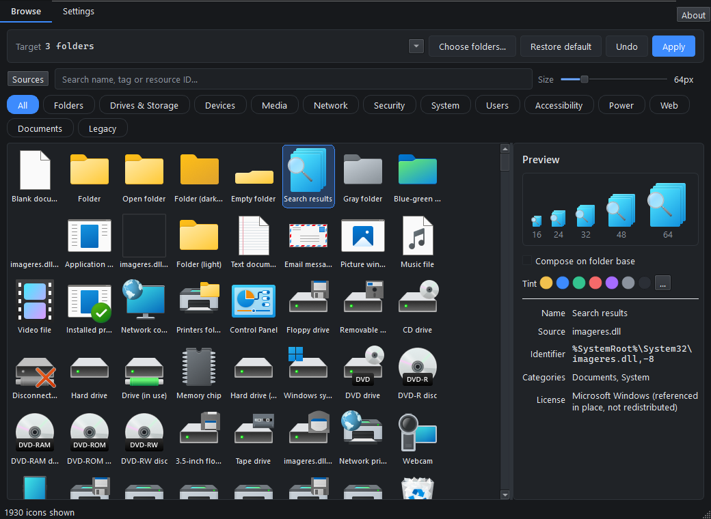
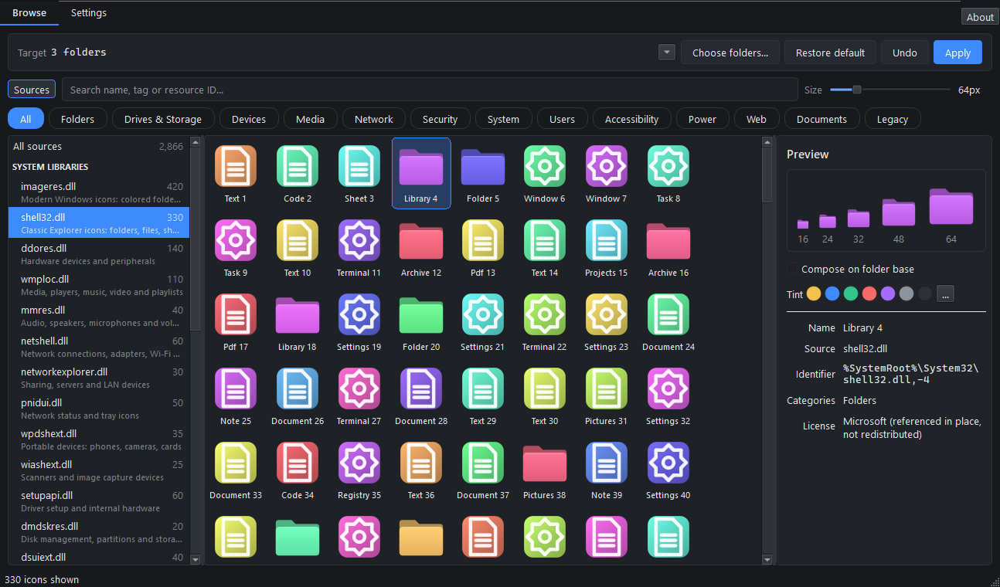
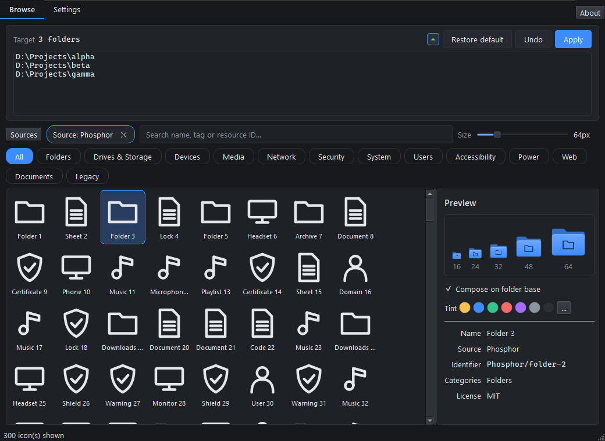
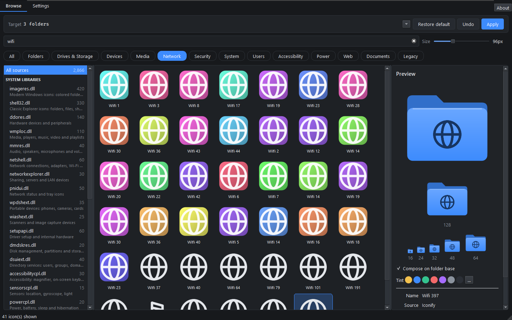
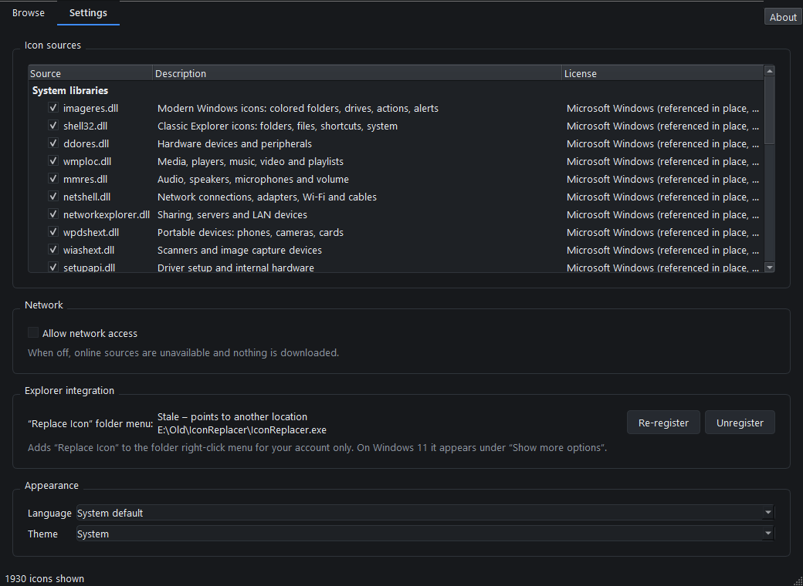

# IconReplacer

A modern, resizable, technical folder icon picker for Windows 10/11. It replaces
the decades-old *Customize > Change Icon* dialog. Right-click a folder, choose
**Replace Icon**, then browse icons by source and category, preview them from 16
to 256 px and apply.

> Status: **UI prototype (validated)**. The data is mocked, and actions are simulated: nothing on
> your system is modified.

## Screenshots

| Light | Dark |
|---|---|
|  |  |
|  |  |
|  |  |

Regenerate the screenshots with `uv run python tools/screenshots.py`.

## Requirements (development)

- Windows 10/11
- [uv](https://docs.astral.sh/uv/)

## Run

```powershell
uv sync
uv run iconreplacer --folder C:\path\to\folder
uv run iconreplacer --version
```

## Test

```powershell
uv run ruff check
uv run pytest
```

## Build a release

```powershell
uv run python tools/build_release.py
```

Produces `dist/IconReplacer-<version>-win64.zip` and a `.sha256` file: a portable PyInstaller
onedir build (`IconReplacer.exe`, console companion `iconreplacer-cli.exe`, LICENSE,
THIRD_PARTY_NOTICES.md, README-PORTABLE.txt). The build compiles translations, generates the
icon and version resource, smoke-tests `--version` and exits non-zero on any failure.
The slow end-to-end test runs with `uv run pytest -m build -o addopts=""`.

## Translations

English is built in. To regenerate the template `src/iconreplacer/i18n/iconreplacer_en.ts`
after a UI string changes, run `uv run python tools/update_translations.py`.

## Versioning

`MAJOR.MINOR.PATCH.BUILD`. `src/iconreplacer/version.py` is the single source. BUILD
increases by one for every change merged into `main` and never resets. Every merge
is tagged `vMAJOR.MINOR.PATCH.BUILD`. Bump with:

```powershell
uv run python tools/bump_version.py build   # or: patch | minor | major
```

## License

MIT. See [LICENSE](LICENSE). Windows system icons are referenced in place and never
redistributed.
