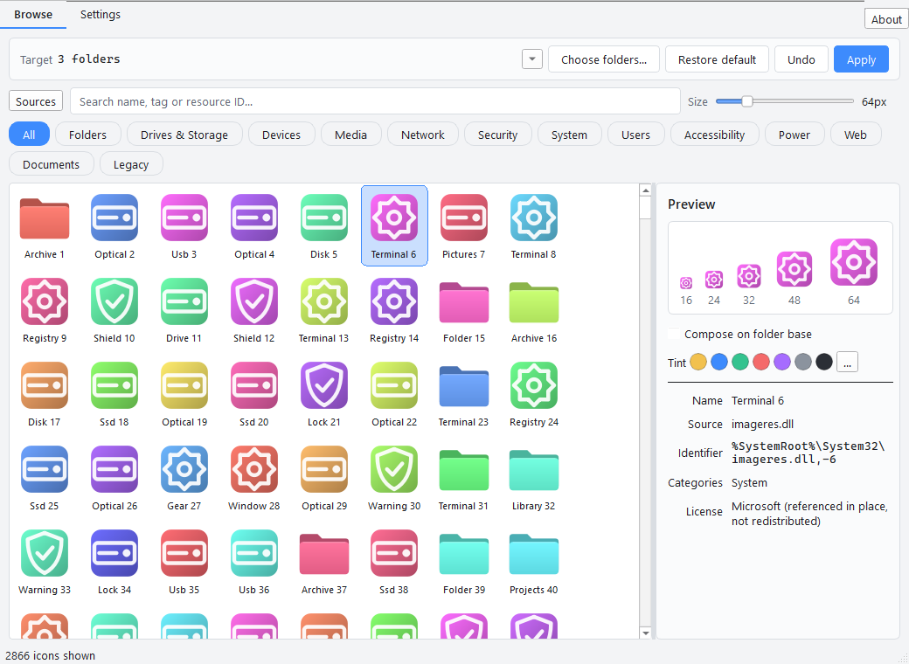
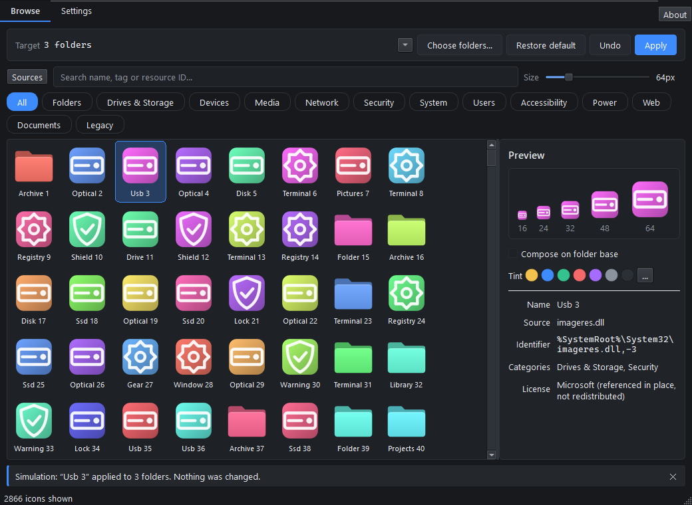
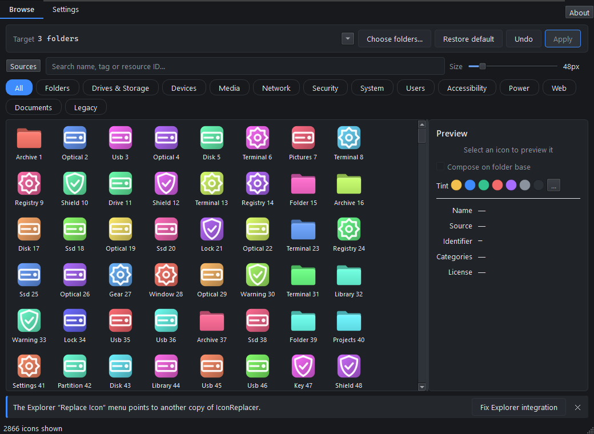

# IconReplacer

A modern, resizable, technical folder icon picker for Windows 10/11. It replaces
the decades-old *Customize > Change Icon* dialog. Right-click a folder, choose
**Replace Icon**, then browse icons by source and category, preview them from 16
to 256 px and apply.

> Status: **1.0** - real folder icons, system, online, GitHub and local sources.
> (referenced in place), and Apply / Undo / Restore default really change the target folders.
> Online, GitHub and local-folder sources are coming next.

## How it works

- Pick target folders with Explorer's **Replace Icon** entry, `--folder`, or **Choose folders…**.
- Select an icon, optionally **Compose on folder base** with a tint, then **Apply**.
- IconReplacer writes `desktop.ini` (and, for composed or converted icons, a generated
  `.iconreplacer\icon-<hash>.ico` inside the folder, so the icon survives moving the folder).
  The previous state is saved, so **Undo** restores it exactly; **Restore default** removes the
  custom icon.
- Batches ask for confirmation. Failures are listed per folder with the reason. System, program
  and profile-root folders, drive roots and links are always refused. No admin rights are needed.

## Screenshots

| Light | Dark |
|---|---|
|  |  |
|  |  |
|  |  |
|  |  |

Regenerate the screenshots with `uv run python tools/screenshots.py`. The tool reads the real
system icons but uses demo target paths, a simulated folder service and an in-memory registry:
nothing on the system is modified.

## Requirements (development)

- Windows 10/11
- [uv](https://docs.astral.sh/uv/)

## Run

```powershell
uv sync
uv run iconreplacer --folder C:\path\to\folder
uv run iconreplacer --version
```

Without `--folder`, use **Choose folders…** in the window (pick repeatedly to add several).

### Explorer "Replace Icon" menu

Register the per-user folder context-menu entry (only `HKCU\Software\Classes\Directory\shell\IconReplacer`
is written; no admin rights):

```powershell
uv run iconreplacer --register     # or Settings > Explorer integration > Register
uv run iconreplacer --status
uv run iconreplacer --unregister
```

On Windows 11 the entry appears under **Show more options**. Selecting several folders opens a
single window with all of them. If the portable folder is moved, the app shows a
**Fix Explorer integration** banner that re-registers the new location.

### Demo mode

`ICONREPLACER_DEMO=1` starts the app with generated demo sources, simulated actions and an
in-memory registry (used by tests and for UI work).

## Test

```powershell
uv run ruff check
uv run pytest
```

## Build a release

```powershell
uv run python tools/build_release.py
```

Produces `dist/IconReplacer-<version>-win64.zip` and a `.sha256` file: a portable PyInstaller
onedir build (`IconReplacer.exe`, console companion `iconreplacer-cli.exe`, LICENSE,
THIRD_PARTY_NOTICES.md, README-PORTABLE.txt). The build compiles translations, generates the
icon and version resource, smoke-tests `--version` and exits non-zero on any failure.
The slow end-to-end test runs with `uv run pytest -m build -o addopts=""`.

## Translations

English is built in. To regenerate the template `src/iconreplacer/i18n/iconreplacer_en.ts`
after a UI string changes, run `uv run python tools/update_translations.py`.

## Versioning

`MAJOR.MINOR.PATCH.BUILD`. `src/iconreplacer/version.py` is the single source. BUILD
increases by one for every change merged into `main` and never resets. Every merge
is tagged `vMAJOR.MINOR.PATCH.BUILD`. Bump with:

```powershell
uv run python tools/bump_version.py build   # or: patch | minor | major
```

## License

MIT. See [LICENSE](LICENSE). Windows system icons are referenced in place and never
redistributed.
